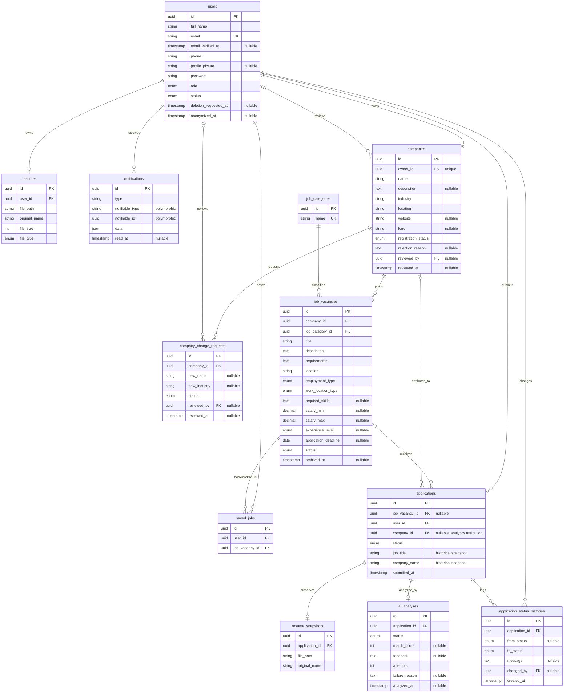

# Shagalni V2

Shagalni V2 is an AI-assisted job board platform connecting Job Seekers with companies. AI evaluates a Resume against a specific Job to assist human review; it never makes final hiring decisions.

## SRS v1.4 Overview

**Version:** 1.4, 9 November 2026  
**Roles:** Admin, Company Owner, Job Seeker  
**User-facing systems:** Backoffice System and Job Seeker Portal  
**Functional modules:** User Management, Company Management, Job Management, Job Search, Resume Management, Application Management, Saved Jobs, AI Resume Processing, Notification Management, Analytics, and Job Categories Management.

### User Management

- Job Seekers register independently. Prospective Company Owners can register through the Job Seeker Portal; one User and one Company are created in Pending Approval.
- Company registration approval requires verified email. Email verification and password reset use links, not OTP. Unverified users may log in and browse but cannot apply.
- Admin-created Company Owners receive a single-use password setup invitation that expires after 48 hours; completing it verifies the email.
- Users manage their profiles but cannot change roles. Account statuses are Active, Suspended, and Deactivated. Suspended users require Admin reactivation; eligible Deactivated users may request a single-use reactivation link valid for 24 hours.
- Users may request deletion. Access is blocked immediately for a 30-day grace period without changing the existing account status. The request can be cancelled once through a secure link. At expiry, the User is anonymized and deactivated; personal Resume, Saved Jobs, and Notifications are removed while historical Applications are retained. The initial Admin is excluded.

### Company Management

- Each Company Owner owns exactly one Company. Admins approve or reject verified registration requests; rejection requires a reason. Only the registering Company Owner receives the decision by email and in-app notification.
- Rejected owners can edit and resubmit using the same User and Company records.
- Company Name and Industry changes require Admin approval. Description, Location, Website, and Logo changes apply directly.
- Suspending or deactivating an owner makes the Company inactive and its Jobs unavailable. Account deletion permanently removes the Company, its Jobs, change requests, and associated bookmarks while preserving Applications.

### Job Management and Search

- Company Owners publish Jobs without Admin approval. Required fields: title, description, requirements, Category, location, employment type, and work location type. Skills, salary range, experience level, and application deadline are optional.
- Employment types: Full-time, Part-time, Internship, Freelance, Contract. Work location: On-site, Remote, Hybrid. Experience: Entry Level, Junior, Mid-Level, Senior.
- Jobs can be closed, archived, and restored within 30 days. Restoring returns the Job status to Active, but eligibility still requires an Approved Company, an Active owner, and an unexpired deadline. Archived Jobs not restored within 30 days are permanently deleted.
- Admins can inspect and manage Jobs, including permanent deletion of Archived Jobs after confirmation. Admins cannot create Jobs or transfer Company ownership.
- Authentication is required to browse and view Jobs. Search supports title, Category, and Location, with newest-first sorting. Closed, Archived, expired, or otherwise ineligible Jobs are hidden and cannot accept Applications.

### Resumes, Applications, Saved Jobs

- Each Job Seeker has at most one current Resume. Only PDF and DOCX files up to 5 MB are accepted; Resume files must be protected from unauthorized access.
- Applying requires an Active account, verified email, a current Resume, and an eligible Job. The Application is created immediately with Pending status, and a Resume Snapshot preserves the submitted Resume.
- Only one active Application per Job Seeker per Job is allowed. Reapplication is allowed after withdrawal if the Job remains eligible.
- Statuses: Pending, Under Review, Shortlisted, Interview, Accepted, Rejected, Withdrawn. The normal progression is sequential; rejection may occur from any non-terminal status. Job Seekers may withdraw from any non-terminal status. Accepted, Rejected, and Withdrawn are terminal.
- Owners review applicants only for their own Jobs. They can view applicant contact/profile details, the Application, its Resume Snapshot, and its AI analysis, but not security fields or other companies' applicants.
- Saved Jobs are independent of Applications. Unavailable saved Jobs remain listed with the reason while the Job exists and can be removed; they cannot be applied to. Permanent Job deletion removes its bookmark.

### AI, Notifications, Analytics, Categories

- AI analyzes only the Resume against the specific Job and returns a matching score and feedback. Only the Company Owner of that Job may view results. AI never changes Application status.
- AI runs in the background after Application submission. Failure does not block or cancel the Application. Retryable transient failures receive at most three automatic attempts per dispatch cycle. Unsupported/invalid input is not retried automatically. After failure, the related Company Owner or an Admin may manually retry without duplicating the Application or analysis.
- The Company Owner is notified after successful Application submission independently of AI. Status changes notify Job Seekers by email and in-app notification only while their account is Active and deletion is not pending. Owners are notified when an Application is withdrawn.
- Admins view platform and any Company analytics; Company Owners view only their own Company's analytics. Job Seekers have no analytics dashboard. Platform analytics include totals and rolling 30-day activity counts. Acceptance/rejection rates use Accepted plus Rejected Applications as the denominator.
- Company analytics include Jobs, Applications per Job, applicant counts, status distribution, and acceptance/rejection metrics. Company attribution on Applications remains after Job deletion for as long as the Company exists.
- Admins manage Job Categories. A Category referenced by a Job cannot be deleted; database RESTRICT behavior prevents deletion without reassignment.

### Non-Functional Requirements

- Enforce authentication, role-based access, data boundaries, Resume file privacy, and rate-limiting for failed logins.
- Paginate large collections, keep AI from blocking Applications, preserve valid data through external-service failures, and prevent duplicate Applications/processing on the backend.
- Support desktop and mobile browsers with distinct Job Seeker and Backoffice experiences. Keep the platform modular without unnecessary complexity.

### Out of Scope

SaaS/multi-tenancy, subscriptions/billing/payments, additional roles or user-facing systems, Admin registration/management, chat/messaging, Application notes, vacancy-count fields, Job Seeker analytics dashboard, AI hiring decisions, and implementation-specific architecture beyond the supplied ERD.

## Entity Relationship Diagram

The following Mermaid ERD reconstructs the supplied diagram and includes SRS v1.4 clarifications: Application-to-Company analytics attribution and account anonymization metadata.

### Relationship Notes

- One Job Seeker has at most one current Resume; each Application preserves its own Resume Snapshot.
- An Application's `company_id` remains set if its Job is deleted, preserving Company analytics. If the Company is deleted, `company_id` becomes null. Deleting a Job also sets `job_vacancy_id` to null while preserving Application history, snapshots, analyses, and status history.
- Notifications use polymorphic recipients (`notifiable_type`, `notifiable_id`), rather than a direct foreign key to one user table.
- Company Owner anonymization retains the User UUID and Role so historical Application ownership can remain intact.

## SRS Traceability

| Module | Requirement IDs |
| --- | --- |
| User Management | FR-01 to FR-28 |
| Company Management | FR-29 to FR-44 |
| Job Management | FR-45 to FR-68 |
| Job Search | FR-69 to FR-77 |
| Resume Management | FR-78 to FR-85 |
| Application Management | FR-86 to FR-99 |
| Saved Jobs | FR-100 to FR-103 |
| AI Resume Processing | FR-104 to FR-112 |
| Notification Management | FR-113 to FR-119 |
| Analytics | FR-120 to FR-126 |
| Job Categories Management | FR-127 to FR-131 |

## Revision History

| Version | Summary |
| --- | --- |
| 1.0 | Initial SRS draft |
| 1.1 | Consolidated requirements and clarified profiles, Company Owner deletion, Application history, and notifications |
| 1.2 | Finalized Job visibility, authentication, suspension, history preservation, and withdrawal notifications |
| 1.3 | Consolidated baseline used for ERD and LLD review |
| 1.4 | Finalized account anonymization, verification gates, portal boundaries, Admin scope, workflow/notification rules, AI access/retry, Saved Jobs, analytics attribution, and ERD amendments |
